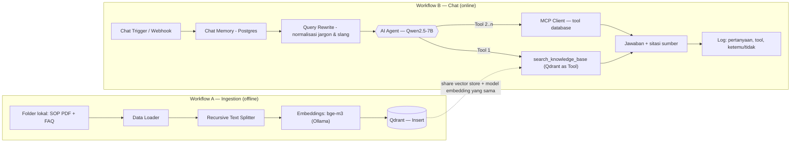

# ChatBox — Prototype Chatbot CS Internal (RAG + Tool Calling via MCP)

Prototype chatbot untuk **information gathering tim internal** Satuinbox/ChatBox:
menjawab pertanyaan dari SOP & FAQ (PDF) dan dari database operasional
(cek ongkir, status pengiriman, detail order) lewat satu Agent percakapan.

> **Status:** Awalan / fondasi (blueprint + scaffold). Belum production.
> Deployment akhir direncanakan di VPS perusahaan atau Mac Mini, bukan di laptop dev.

---

## Keputusan desain yang sudah dikunci

| # | Keputusan | Alasan |
|---|-----------|--------|
| 1 | Arsitektur **RAG + Agent tool calling**, BUKAN fine-tuning | Pengetahuan (SOP, ongkir, status) berubah terus dan harus bisa dikutip sumbernya. Fine-tuning mengubah *perilaku* model, bukan memberinya fakta baru; fakta yang di-fine-tune cepat basi dan tidak bisa diaudit sumbernya. |
| 2 | **Dua workflow terpisah**: Ingestion & Chat | Ingestion jalan saat dokumen berubah; chat jalan tiap pertanyaan. Mencampur keduanya = boros dan salah arsitektur. |
| 3 | Embedding **bge-m3** (lokal, via Ollama) | Gratis (MIT), 100+ bahasa termasuk Indonesia, 1024 dimensi, context 8.192 token, ringan di CPU (~1,1 GB RAM). |
| 4 | LLM lokal **Qwen2.5-7B-Instruct Q4** (via Ollama) untuk versi data asli | Data SOP/database bersifat rahasia. Chunk hasil RAG ditempel ke prompt LLM, jadi LLM eksternal = data ikut terkirim keluar. |
| 5 | Vector DB **Qdrant** (self-host, Docker) | Gratis, node native di n8n, filter metadata kuat. |
| 6 | Tool database lewat **MCP Client** di n8n | MCP Server membungkus API/database dan mempublikasikan tool + skemanya ke Agent. Lihat `docs/mcp-tool-contract.md`. |
| 7 | Jawaban dari SOP **wajib sitasi** (nama file + bab/halaman) | User internal perlu verifikasi, bukan sekadar percaya jawaban bot. |
| 8 | Semua alamat & kredensial lewat `.env` | Prototype harus portable: pindah laptop → Mac Mini/VPS cukup ganti `.env`. |

## Yang BUKAN bagian dari project ini

- **Fine-tuning** — bukan tahap saat ini. Opsi lanjutan *terpisah* hanya jika evaluasi
  membuktikan format/perilaku jawaban tidak bisa diperbaiki lewat prompt
  (misal: format output berantakan konsisten, Agent sering salah pilih tool).
  Itupun bentuknya adapter perilaku (LoRA), bukan menghafal SOP.
- **User eksternal / customer** — fase sekarang khusus tim internal.
- **Training model di komputer dev** — yang berjalan di laptop adalah
  *indexing* (embedding dokumen ke Qdrant) dan *inference* (model menjawab),
  bukan training.

## Arsitektur ringkas



Detail per node: `docs/architecture.md`.

## Stack

| Komponen | Teknologi | Jalan di |
|----------|-----------|----------|
| Orkestrasi | n8n (self-host) | Docker |
| Database n8n + chat memory + log | PostgreSQL | Docker |
| Vector DB | Qdrant | Docker |
| Embedding + LLM | Ollama (`bge-m3`, `qwen2.5:7b-instruct-q4_K_M`) | **Native di OS** (bukan Docker — lihat catatan Mac di `docs/deployment.md`) |
| Tool database | MCP Server perusahaan (menyusul) / mock tool | Jaringan internal |

## Cara jalanin (dev, di laptop)

Prasyarat: Docker Desktop + Ollama terinstall.

```bash
ollama pull bge-m3
ollama pull qwen2.5:7b-instruct-q4_K_M
cp .env.example .env   # isi sesuai mesin kamu, JANGAN commit .env
docker compose -f infra/docker-compose.yml up -d
# n8n di http://localhost:5678 — bangun workflow mengikuti docs/architecture.md
```

Catatan hardware dev (Acer Aspire 5, i5, RAM 16GB, tanpa GPU discrete):
LLM 7B di CPU berjalan ±3–8 token/detik. Cukup untuk membangun & menguji
workflow, tidak untuk demo cepat. Di Mac Mini Apple Silicon, kelas model
yang sama berjalan puluhan token/detik.

## Roadmap

- [x] **Fase 0** — Blueprint, keputusan desain, kontrak tool, scaffold repo (ini)
- [ ] **Fase 1** — RAG saja: ingestion SOP/FAQ dummy → chat internal bisa jawab + sitasi
- [ ] **Fase 2** — MCP asli dicolok (mock tool di `mock/` diganti MCP Client), data dummy diganti data asli + LLM full lokal
- [ ] **Fase 3** — Migrasi ke Mac Mini/VPS + integrasi web Satuinbox (Chat Trigger diganti Webhook)
- [ ] **Fase 4 (opsional, dievaluasi terpisah)** — Fine-tuning perilaku/format jika prompt terbukti tidak cukup

## Struktur repo

```
README.md                  ← dokumen ini
docs/architecture.md       ← diagram + workflow n8n per node
docs/mcp-tool-contract.md  ← API vs MCP, kontrak tool yang diusulkan, aturan keamanan
docs/deployment.md         ← laptop vs Mac Mini vs VPS, langkah migrasi
docs/known-limitations.md  ← keterbatasan & blocker saat ini (MCP belum diterima, dll)
prompts/                   ← prompt Agent & prompt query-rewrite (file terpisah, bukan hardcode di node)
infra/docker-compose.yml   ← n8n + Postgres + Qdrant
mock/                      ← respon dummy tool database untuk demo sebelum MCP asli datang
eval/test-set.md           ← daftar pertanyaan uji + hasil yang diharapkan
data/                      ← tempat file SOP/FAQ lokal (isinya TIDAK di-commit, lihat data/README.md)
n8n/                       ← panduan membangun workflow + tempat export JSON workflow
.env.example               ← template konfigurasi (tanpa kredensial asli)
```

## Aturan keamanan data (non-nego)

1. File SOP/FAQ asli dan `.env` **tidak pernah** masuk Git (sudah di-`.gitignore`).
2. Versi yang memakai data asli wajib full lokal: embedding lokal, LLM lokal.
   LLM eksternal hanya boleh untuk data dummy (Fase 1 awal).
3. Tool database harus **read-only, parametrik, dan terbatas** — tidak ada tool SQL bebas.
4. MCP Server / database tidak boleh terekspos ke internet publik saat deployment.
5. Log chat menyimpan pertanyaan & tool yang dipanggil, bukan kredensial atau data pribadi utuh (masking).
